# StereoCrafter Studio

A Windows app for non-commercial research, education and experimentation that turns 2D video into stereoscopic 3D
with the StereoCrafter pipeline, one stage at a time:

    Scene Cut -> DepthCrafter -> Splatting -> Inpainting -> Merging
                 depth maps      warp to 3D   fill holes    final side-by-side

plus the **Depth Map Editor** (fix a depth map object by object, erase objects from a clip) and **Edge Fill**
(refill the strip a strong 3D shift uncovers at the frame's edge). Each stage hands its output to the next, and
a project folder keeps every chapter of a long video in order.

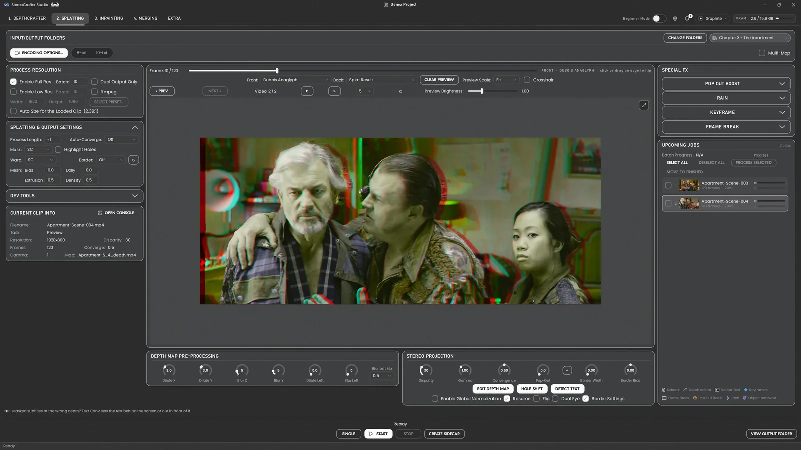

The full manual is inside Studio: press **F1**, or open `docs/manual/index.html`.

> **Licence -- read this first.** The StereoCrafter, StereoCrafter2 and DepthCrafter models and the StereoCrafter
> inference code are licensed by Tencent **for academic, research and education purposes only -- no commercial or
> production use** (`License-Code.txt`, and the `LICENSE` beside each model). Stable Video Diffusion is under the
> Stability AI Community License. The other components are listed in
> [THIRD_PARTY_NOTICES.md](THIRD_PARTY_NOTICES.md).

## Features

### The whole pipeline in one app

- **Scene Cut** finds a long video's shot boundaries and cuts it into clips, one folder per chapter: AutoShot,
  TransNetV2 or OmniShotCut, optional AI validation, frame-exact 10-bit HEVC clips, and the video's own chapter
  markers to split it.
- **DepthCrafter** makes a depth map for each clip, sized for you (Auto Size, per-ratio presets, your own presets).
- **Splatting** warps each clip to the right eye's view: Pop-Out Boost, keyframes on its dials (with LFO and
  custom-curve shapers), **Rain** separated onto its own layer, burned-in text kept flat on the screen
  (**Detect Text**), and a 3D preview -- anaglyph, side by side, or a glasses-free 3D display.
- **Inpainting** fills the holes with StereoCrafter (V1) or, for problem scenes, **StereoCrafter2 on Wan VACE**
  (V2, experimental) -- with a one-click **Download V2 Weights** that fetches only the 46.6 GB V2 uses.
- **Merging** puts each filled right eye back with its full-resolution source: colour matching, **film grain** on
  the fills, every common output format with colour tags, erased objects laid back in at their own depth
  (**Put Back**), and **Merge All** to join a whole project into one side-by-side video.
- **Depth Map Editor**: **SAM 3** selects and tracks objects (or draw a shape on a still shot); change their depth,
  draw gradients for things that recede, keyframe it, take out DepthCrafter's left-edge specks (Despeck), and
  **erase objects from the clip itself with ROSE**. Undo / Redo, a 3D check before rendering, and an edit history
  Splatting reads.
- **Edge Fill** refills the dark strip a strong 3D shift leaves at the frame's edge, with ROSE, from a grid of
  every clip's strip.

### Faster

Measured on a 16 GB RTX 5060 Ti against the GUIs Studio grew from:

- **Inpainting V1**
  - **30-45% faster per chunk** at the default Guidance Scale 1.0: each step is filled once instead of twice
    (the original GUI always ran 1.01, which doubles every step for a near-identical result).
  - **SageAttention 2** on by default, and optional **Torch Compile** on top of it: compile with Sage is about
    **10% faster than SageAttention 2 alone** (about 21% faster than neither), after a one-time warm-up.
  - A one-token cross-attention shortcut (**7% faster per step**) and an fp16 VAE encode (**7% faster per
    chunk**), both with the same picture.
  - An ETA for the clip and the batch.
- **DepthCrafter**
  - An fp16 VAE encode and the one-token cross-attention shortcut: **7% faster per clip** (the encode alone 40%),
    with the same depth.
  - **SageAttention** on by default, and a VRAM cap with sliced feed-forward so long clips fit a 16 GB card.
  - Segments saved uncompressed, frames counted without decoding and no extra copies when merging: less waiting
    on the disk.
  - A larger decode chunk: **7% less flicker** at the same speed.
- **Inpainting V2**: stopped or crashed clips **resume from their last finished chunk** instead of starting over;
  a 64-px tile overlap by default (**12% faster** than 128, no visible seam); MMGP streaming and FP8 modes for
  16-24 GB cards.
- **On the GPU everywhere it can be**: Splatting's depth pre-processing, Detect Text, Rain and the encoder feed;
  Merging's colour transfer and film grain. Every stage hands the GPU back when another starts, and nothing in the
  window redraws while a job runs, so the job never waits on the interface.

### An overhauled interface

- **Fully live preview controls** in Splatting and Merging: every dial and setting redraws the preview as you
  change it, with a scrubber, mark in / out and a full-size preview.
- **Clip lists on every stage** with each clip's aspect ratio, frame count and what has been done to it at a
  glance, and a **Current Clip Info** panel with the clip's resolution and settings as it's worked on.
- Every stage laid out the same way: folders, the clip list, the settings, then one action bar to start, stop
  and follow the job.

### Built for end-to-end conversion

- **Projects**: folder layouts for one long video or an episodic series, a project picker in the title bar, a
  chapter picker on every stage, and each stage remembering where it was per project.
- **Hand-offs**: Import from the previous stage and Send to the next, so folders are never typed twice.
- **Upcoming Jobs** on every stage: tick clips and Process Selected, finished clips turn green, badges for edited
  depth, erased objects and Rain; right-click to play a clip, open it in Explorer, Test Render it or move it on.
- **Stop the way you mean it**: now, after this chunk, or after this clip -- and carry on later.
- **A tabbed console** with a live progress bar for every stage, Windows notifications when a job finishes while
  Studio is minimised, and how long each job took.
- **Check for Updates** built in, a one-click installer, and first-run checks for the driver and FFmpeg.

### Easy on the eyes

- **16 themes**, dark and light: Graphite, Light, True Black, The Nile, Ink, Nord, Warm Carbon, Plum, Teal Slate,
  Paper, Frost, Orchid, Sea Glass, Bone, Moss and Fern -- with frosted glass, a film-grain backdrop and an app icon
  picker.
- **Beginner Mode** (the switch in the title bar) hides the advanced settings while you learn, with plain names
  beside the technical ones.
- Keyboard shortcuts with a legend, tips for every stage, and a **searchable offline manual** -- **F1** opens the
  page for the stage you're on.

## Screenshots

The example footage is from *Tears of Steel* (CC-BY 3.0, (CC) Blender Foundation | mango.blender.org).

<table>
  <tr>
    <td width="50%">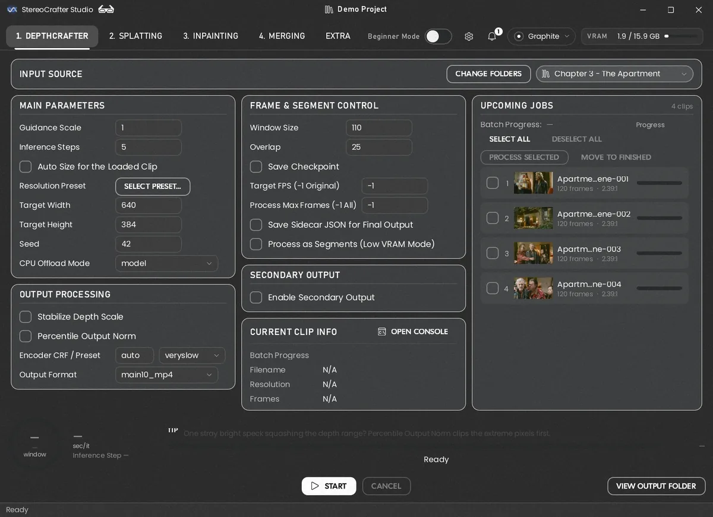<br><b>DepthCrafter</b>: a chapter's clips in Upcoming Jobs, sized for you</td>
    <td width="50%">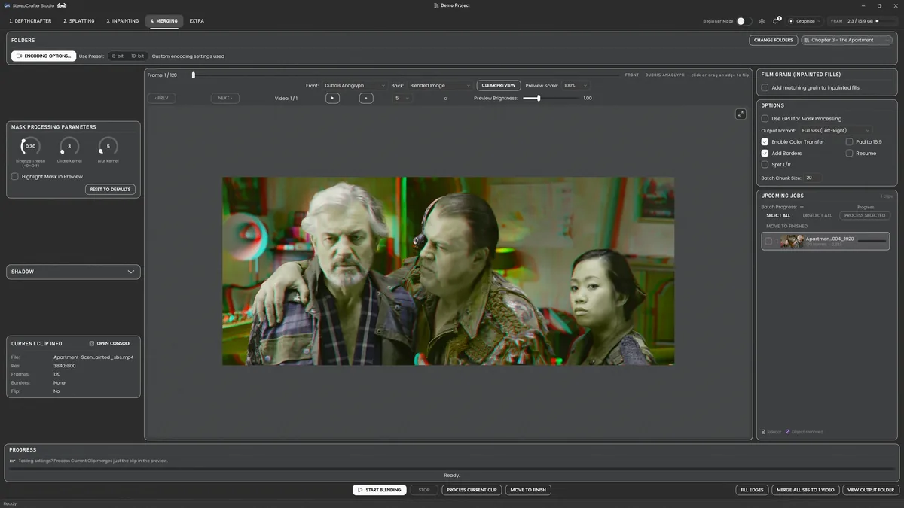<br><b>Merging</b>: the filled right eye back with its source, previewed live</td>
  </tr>
  <tr>
    <td>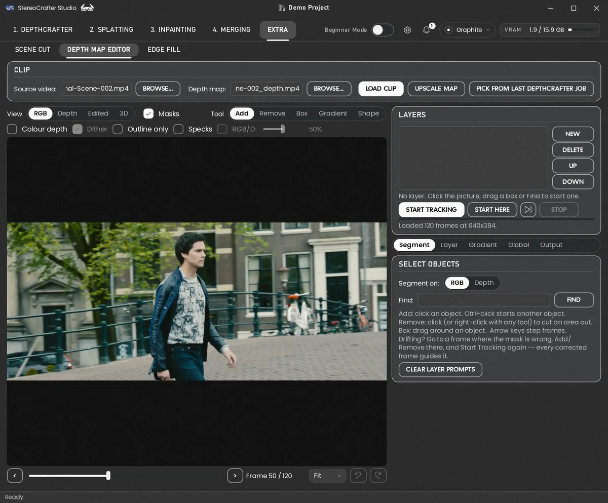<br><b>Depth Map Editor</b>: select objects with SAM 3, change their depth, erase them</td>
    <td>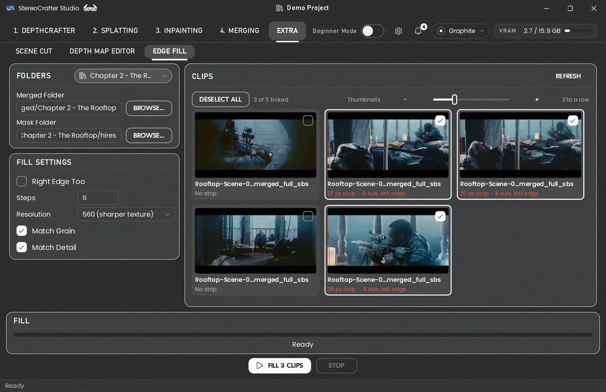<br><b>Edge Fill</b>: every clip's edge strip at a glance, refilled with ROSE</td>
  </tr>
  <tr>
    <td>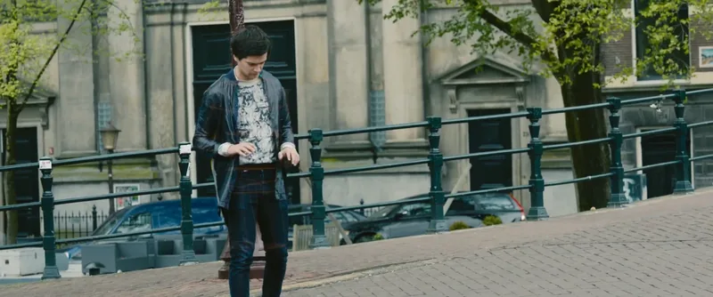<br><b>Erase from Clip</b>: before</td>
    <td>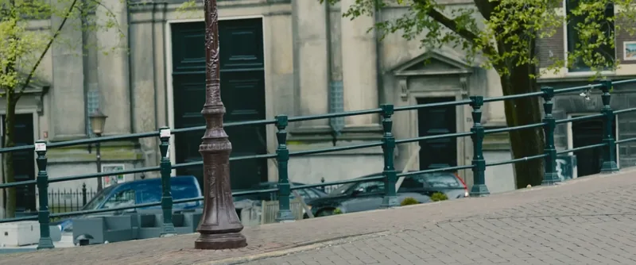<br>...and after: the man gone, the lamp post he passed restored</td>
  </tr>
  <tr>
    <td colspan="2">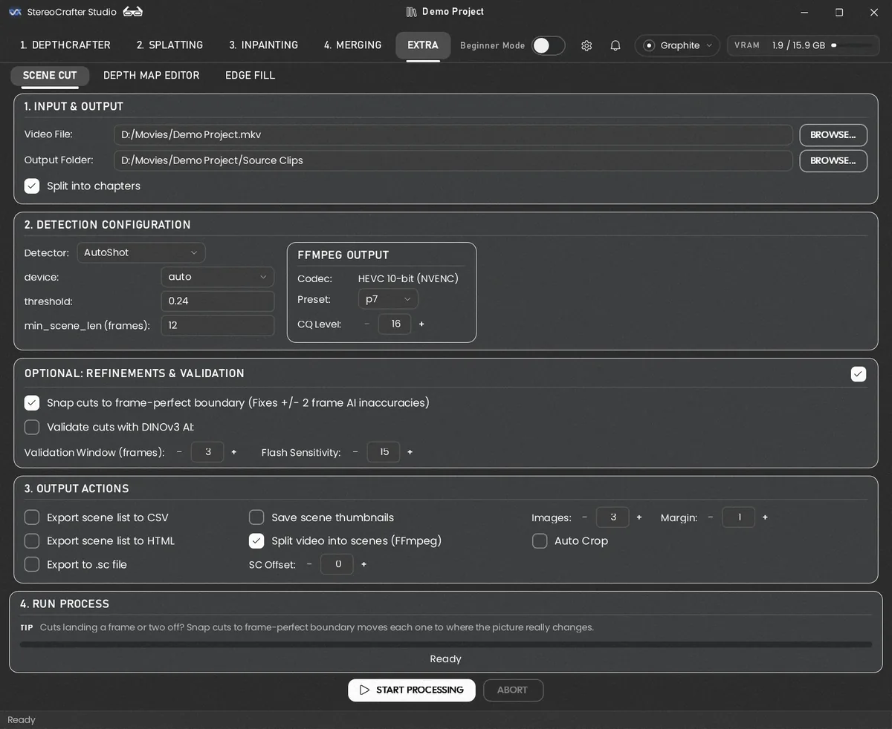<br><b>Scene Cut</b>: a whole video into shot clips, a folder per chapter</td>
  </tr>
</table>

### Themes

<table>
  <tr>
    <td width="33%">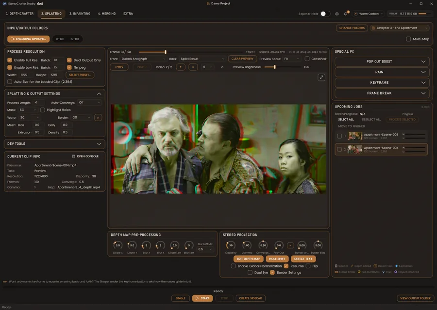<br>Warm Carbon</td>
    <td width="33%">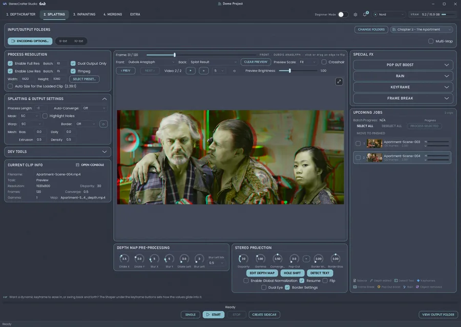<br>Nord</td>
    <td width="33%">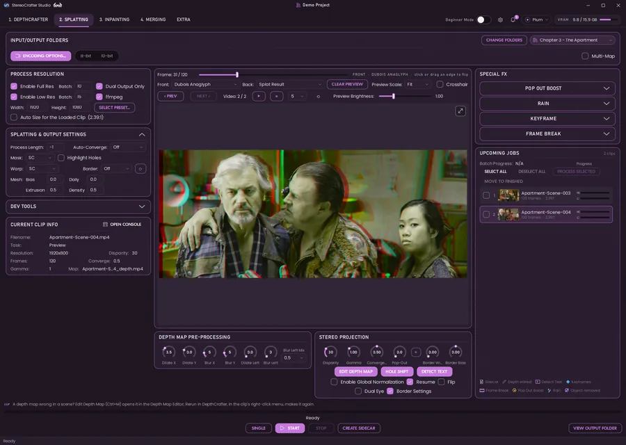<br>Plum</td>
  </tr>
  <tr>
    <td>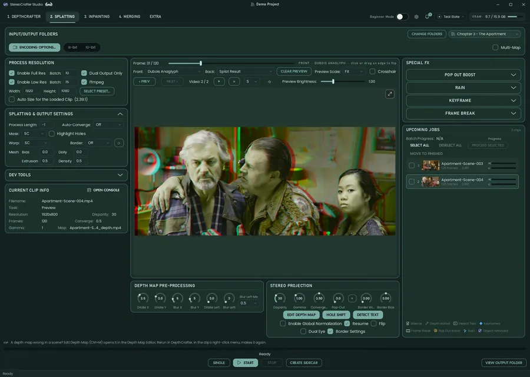<br>Teal Slate</td>
    <td>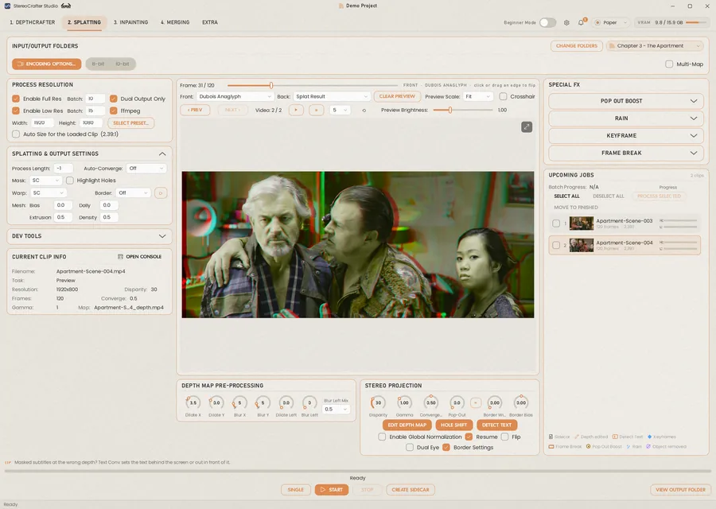<br>Paper</td>
    <td>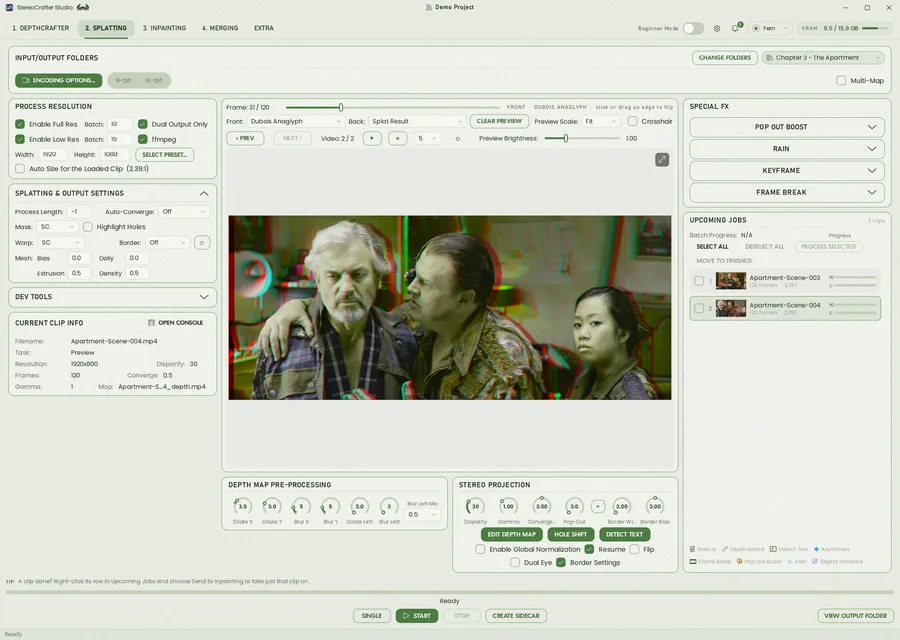<br>Fern</td>
  </tr>
</table>

## Requirements

- Windows 10 or 11, 64-bit.
- An **NVIDIA graphics card**, RTX 20 series or newer. 16 GB of VRAM is what the defaults are set for; on 8-12 GB,
  turn on DepthCrafter's *Process as Segments (Low VRAM Mode)* and use smaller Splatting batches.
- **NVIDIA driver 580 or newer.** The CUDA Toolkit is **not** needed: PyTorch brings its own CUDA.
- **FFmpeg** -- a full build, with `ffprobe` -- with its `bin` folder on your PATH.
- Git (the installer installs it with winget if it's missing).
- About 30 GB of disk for Studio and its core models; more for the optional ones below (Inpainting V2 takes
  46.6 GB, plus 17.4 GB for its FP8 mode).

Studio checks the driver and FFmpeg when it starts and tells you what's missing.

## Installing

1. Put `_install/StereoCrafter_1click_Installer.bat` in the folder you want Studio in, and run it. It installs
   [uv](https://docs.astral.sh/uv/), Python 3.13 and every package, then offers to download the core models.
2. The core models are about 22 GB. One of them, Stable Video Diffusion, is **gated**: before you start, accept its
   terms at <https://huggingface.co/stabilityai/stable-video-diffusion-img2vid-xt-1-1> and create a read token at
   <https://huggingface.co/settings/tokens> -- the installer asks for it.

To install by hand instead, see [_install/StereoCrafter_Manual_Install.md](_install/StereoCrafter_Manual_Install.md).
To update later, run `_update.bat`.

## Starting

Double-click **StereoCrafter Studio.exe** (or `StereoCrafter Studio.bat`, or run `uv run python -m studio.app` in
the folder). For a desktop shortcut, right-click the .exe > **Send to** > **Desktop (create shortcut)** (on Windows
11, **Show more options** first), or pin it to the taskbar; the **App Icon** picker in the theme popout changes its
icon's colour live. Then set a project folder -- **Settings** (the gear) > **Studio** > **Set Project Folder** --
and Studio keeps each stage's input and output for every chapter there. Until you do, each stage's folders are under
`Videos\StereoCrafter Studio`.

## Models

**Settings > Studio > Models** lists every model, whether it's on this PC, and a **Download** for each one
missing -- only the files Studio loads, from a pinned revision. There you can also:

- **point Studio at another models folder** (another drive, or one two installs share). Nothing is moved:
  Studio looks there first, then in its own `weights/` for anything not moved yet, and downloads go there.
- **sign in to Hugging Face** for the gated models (Stable Video Diffusion, SAM 3, DINOv3): ask for access on
  each one's page, make a *Read* token at <https://huggingface.co/settings/tokens> and paste it in. It's stored
  where `hf auth login` stores it, never in Studio's settings.

One download runs at a time, the rest queue, and a download waits while a job runs.

**Already have StereoCrafter?** Point the models folder at its `weights` folder: Studio looks for the same folder
names (`stable-video-diffusion-img2vid-xt-1-1`, `DepthCrafter`, `StereoCrafter`, `SceneCut/`), so there's nothing
to download again. A model that folder doesn't have downloads into it; ROSE needs **Set Up ROSE** again.

| Model | Used by | Folder (in the models folder) | Download |
| ----- | ------- | ----------------------------- | -------- |
| Stable Video Diffusion img2vid-xt 1.1 (gated): its VAE + image encoder, 1.5 GB | DepthCrafter, Inpainting | `stable-video-diffusion-img2vid-xt-1-1` | Models (or the installer: the whole 18 GB repository) |
| DepthCrafter (3.0 GB) | DepthCrafter | `DepthCrafter` | Models, or the installer |
| StereoCrafter (3.0 GB) | Inpainting | `StereoCrafter` | Models, or the installer |
| SAM 3 (gated, 3.4 GB) | Depth Map Editor | `SAM3/sam3.pt` | Models, or **Download Weights** on the editor's Segment page |
| ROSE (about 3.7 GB, its own environment) | Erase from Clip, Edge Fill | `ROSE` | **Set Up ROSE** in the Depth Map Editor's Erase panel |
| OmniShotCut (164 MB) | Scene Cut | `SceneCut/OmniShotCut_ckpt.pth` | Models |
| TransNetV2 | Scene Cut | comes with Studio (the `transnetv2-pytorch` package) | -- |
| AutoShot | Scene Cut | `SceneCut/ckpt_0_200_0.pth` | only in the [SceneCutGUI checkpoint bundle](https://drive.google.com/file/d/1aJ96eJE4DstJ_HBzAusuYLvfU01Jnc92/view?usp=sharing) on Google Drive |
| DINOv3 ViT-L/16 (gated, 1.2 GB) + SSCD (178 MB) | Scene Cut's cut validation | `SceneCut/DINOv3/`, `SceneCut/sscd_disc_large.torchscript.pt` | Models |
| Wan 2.1 VACE's text encoder, VAE and tokenizer (11.9 GB) + StereoCrafter2 (34.7 GB): 46.6 GB | Inpainting V2 (experimental) | `Wan2.1-VACE-14B-diffusers`, `StereoCrafter2` | Models, or **Download V2 Weights** on Inpainting V2's page (not VACE's own 59 GB transformer); FP8 resident mode: StereoCrafter2 FP8 (17.4 GB, `StereoCrafter2-FP8`) |

Each stage says which model it's missing when you press Start.

Inpainting V2 is experimental: much more demanding than V1 and much slower, for problem scenes where V1 isn't good
enough, not a whole long video.

## Licence

StereoCrafter Studio's own code is Copyright (c) 2026 subtlewubs, released under the same terms as the
StereoCrafter inference code it is built on, in [License-Code.txt](License-Code.txt): free to use, copy, modify and
share for academic, research and education purposes -- not for commercial or production use -- keeping the
copyright notices. The code and models it includes keep their own licences, listed in
[THIRD_PARTY_NOTICES.md](THIRD_PARTY_NOTICES.md).

**Not affiliated with Tencent.** StereoCrafter Studio is an independent project. It is not affiliated with,
endorsed by or sponsored by Tencent, THL A29 Limited or the authors of StereoCrafter, StereoCrafter2 or DepthCrafter;
their names here only say which models and code Studio is built on.

**What you convert is your responsibility.** Use Studio only on video you own or have the rights to work with, and
only within the licences above: academic, research and education use, never commercial or production use -- for
Studio and for what you make with it. Studio does not decrypt, rip or get around copy protection, and nobody
involved in it accepts responsibility for how it is used.

## Credits

StereoCrafter Studio is built by subtlewubs ([NowIAmBecomeDepth](https://github.com/NowIAmBecomeDepth) on GitHub) on the StereoCrafter suite. It includes work from:
DepthCrafter GUI Seg by Billynom8 (<https://github.com/Billynom8/DepthCrafter_GUI_Seg>); the StereoCrafter GUI suite,
its installer and SceneCutGUI by enoky (<https://github.com/enoky/StereoCrafter>,
<https://github.com/enoky/SceneCutGUI>); and the models and projects listed in
[THIRD_PARTY_NOTICES.md](THIRD_PARTY_NOTICES.md). The manual's appendix lists them all.

<hr>
<div align="center">
<h2>StereoCrafter: Diffusion-based Generation of Long and High-fidelity Stereoscopic 3D from Monocular Videos</h2>

Sijie Zhao*&emsp;
Wenbo Hu*&emsp;
Xiaodong Cun*&emsp;
Yong Zhang&dagger;&emsp;
Xiaoyu Li&dagger;&emsp;<br>
Zhe Kong&emsp;
Xiangjun Gao&emsp;
Muyao Niu&emsp;
Ying Shan

&emsp;* equal contribution &emsp; &dagger; corresponding author

<h3>Tencent AI Lab&emsp;&emsp;ARC Lab, Tencent PCG</h3>

<a href='https://arxiv.org/abs/2409.07447'></a> &emsp;
<a href='https://stereocrafter.github.io/'></a> &emsp;
<a href='https://huggingface.co/TencentARC/StereoCrafter'></a>
</div>

StereoCrafter converts any 2D video to immersive stereoscopic 3D for 3D glasses, headsets such as Apple Vision Pro,
and 3D displays -- movies, vlogs, 3D cartoons and AI-generated video alike.

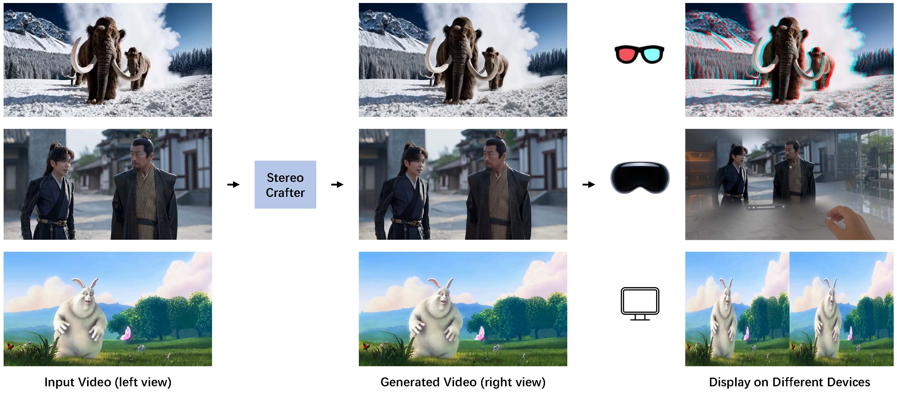

<div align="center">
    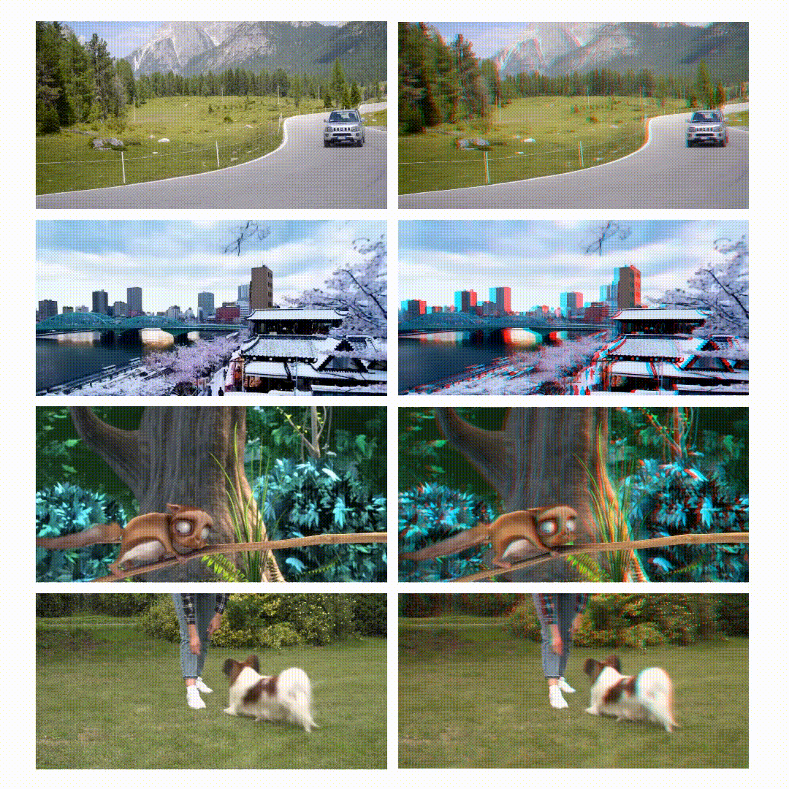
</div>

The StereoCrafter authors thank [Stable Video Diffusion](https://github.com/Stability-AI/generative-models) and
[DepthCrafter](https://github.com/Tencent/DepthCrafter).

```bibtex
@article{zhao2024stereocrafter,
  title={Stereocrafter: Diffusion-based generation of long and high-fidelity stereoscopic 3d from monocular videos},
  author={Zhao, Sijie and Hu, Wenbo and Cun, Xiaodong and Zhang, Yong and Li, Xiaoyu and Kong, Zhe and Gao, Xiangjun and Niu, Muyao and Shan, Ying},
  journal={arXiv preprint arXiv:2409.07447},
  year={2024}
}
```
